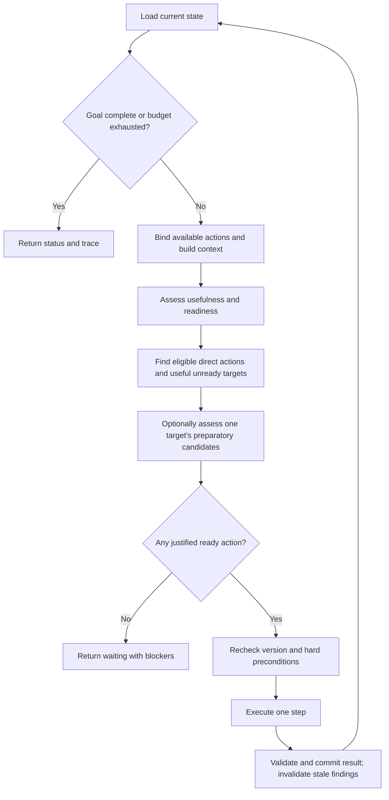

# System One decision loop architecture

Status: proposed experimental design. Implement separately from action ranking.

## Purpose and reasoning

Build a reusable loop that chooses both external actions and actions that improve
the agent's knowledge: observing, calculating, checking, or asking. The same
control flow should work for trading, travel, and other domains. A domain supplies
the available operations and their implementations; universality does not imply
understanding arbitrary text or inventing executable tools.

The existing ranker asks whether an action is relevant. Relevance alone does not
establish that the agent has enough evidence to execute it. The
[prompt experiments](experiments/action-ranking-2026-10-17/README.md) found useful
recognition of explicit prerequisites alongside failures on numerical tradeoffs
and research costs. This design tests whether asking directly about readiness
and missing prerequisites improves decisions. It is a hypothesis, not an
established improvement.

Use System One for bounded contextual judgments. Ordinary code owns action
identity, explicit preconditions, execution, state transitions, budgets, and
traceability. Arithmetic belongs to an available calculation operation when the
domain provides one. Selecting that operation remains part of the experiment.

State is the central contract. Every cycle must distinguish what is known, what
has been computed, what happened, and what remains unresolved. A useful research
action changes the next decision's evidence; an unsuccessful action must also
change the loop's understanding of what can be tried next.

## Scope and assumptions

Start with one agent, one state writer, a fixed action catalog, and sequential
execution. Each operation has a trusted handler with validated arguments and
defined result semantics. No new dependencies are needed for this prototype.

Support structured domain facts plus narrative observations. Treat narrative as
evidence for judgment, not as automatically executable formulas or arguments.
When an operation needs a value that exists only in prose, supply a domain
extractor or an explicit information-gathering operation. Record its result and
provenance before using the value. This design does not solve extraction by
assuming it has already happened.

Costs, deadlines, permissions, and irreversible effects remain explicit domain
constraints. Model readiness is advisory; deterministic preconditions must also
pass. Side-effecting integrations can be added once their execution and recovery
contracts are defined. Begin with simulations and read-only handlers.

## Core components

| Component | Owns |
| --- | --- |
| State store and reducer | Current snapshot, validated updates, versions, dependency invalidation |
| Domain adapter and catalog | Goal checks, candidate operations, argument binding, preconditions, action results |
| Context builder | Deterministic projection of relevant state and action descriptions |
| System One assessor | Typed questions, response validation, model and prompt metadata |
| Selection policy | Eligibility, configurable score gates, stable ordering, abstention |
| Executor | One handler invocation, execution identity, outcome and failure classification |
| Controller and trace | Cycle orchestration, budgets, stopping, complete decision history |

Keep the reducer, context builder, and policy pure. The controller composes them;
it does not interpret domain math or rewrite facts itself.

## State model

Use a versioned JSON-serializable snapshot. Keep the current decision view small;
retain previous snapshots and model responses in the trace rather than appending
an unlimited conversation to the model context.

| Field | Meaning |
| --- | --- |
| `version` | Monotonically increasing committed state revision |
| `intent` | Stable goal ID and revision, description, objective, constraints, completion condition |
| `facts` | Current world values and observations with stable IDs and provenance |
| `findings` | Derived results, assumptions, input dependencies, and validity |
| `open_issues` | Domain-reported unknowns, conflicts, or unmet prerequisites |
| `execution_records` | Attempts, completed work, failures, and ambiguous outcomes |
| `resources` | Observed domain resource balances and domain allowances |

The intent changes only through an explicit caller update. An action cannot
silently relax a deadline or substitute an easier objective.

Keep orchestration budgets in a controller-owned run ledger: model calls, action
attempts, elapsed time, and their limits. Include remaining allowances in decision
context, but consuming a model call does not create a new world-state revision.
Check the ledger again before each call and execution; assessments do not grant
permission to exceed a budget. Charge failed attempts as well as successes.

### Facts and derived findings

A fact has an ID, JSON value, source, observation time when available, and the
revision when accepted. Use domain-defined units for quantities. Absence means
unknown; zero, false, and an empty collection remain actual values. An adapter
may attach an expiry or a source revision when the domain requires freshness.

A finding additionally names the exact fact and intent revisions it used, its
method or handler, and any assumptions. For example, a profit calculation depends
on the cash, inventory, offer, and future-price revisions. A route result depends on
origin, destination, travel mode, and the relevant map observation.

Distinguish a successfully computed result from a prediction. A calculation can
be correct under its assumptions while the future price remains uncertain.
Store the distribution or conditional result supplied by the handler; keep its
assumptions visible in the next context.

Changing a dependency invalidates dependent findings transitively. Preserve
invalidated results in history and mark them stale in the snapshot. Exclude them
from current decision evidence. This prevents a previously correct calculation
from justifying action after prices, inventory, or the objective change.
Resolved issues retain links to their supporting evidence; reopen them when
that evidence becomes stale or conflicted.

Conflicting observations become an explicit conflict or are resolved by a
documented domain source policy. Arrival order alone does not establish truth.
Unresolved conflicts make the affected input unavailable to hard preconditions.

### Assessments are not facts

Model probabilities belong to a decision record associated with a state version
and catalog version. They do not update world facts, prove completion, or create
verified findings. A high readiness score cannot become evidence that the action
is ready in the next cycle.

Represent catalog-supplied possible prerequisites as candidates. A model can
judge whether they matter, but cannot create a verified fact that a prerequisite
has been satisfied. Unexpected unknowns can be recorded by handlers or caller
observations as open issues. Automatic issue generation from arbitrary prose is
a separate extension.

## Actions and execution results

Each action specification supplies:

- Stable ID, description, and argument schema with domain-provided bindings.
- Expected purpose, costs, time, and whether it changes the external world.
- Explicit preconditions and the fact or finding revisions it consumes.
- A handler and its accepted result types.

Descriptions must distinguish inspection from modification and clarify what
research would establish. Names alone are insufficient. Research and execution
use the same interface; a mandatory action category hierarchy is unnecessary.

Return an execution ID, status, observations, requested fact changes, derived
findings, resolved or newly opened issues, and actual resource usage. The handler
may request updates only within the fields its domain contract owns. The reducer
validates the entire result before committing it.

Use these outcome statuses:

| Status | State consequence |
| --- | --- |
| `succeeded` | Commit validated observations and effects; success alone does not imply goal completion |
| `failed` | Record failure and actual resource use; preserve any independently confirmed observations |
| `unknown` | Record uncertain external effects and require reconciliation before a dependent action |

Missing data and rejected preconditions should identify the relevant issue when
known. A failed lookup establishes that this attempt failed, not that the fact
does not exist. A timeout after submitting a purchase can mean the purchase
succeeded; it is not evidence that cash and inventory stayed unchanged.

## State transition contract

Use the same reducer for accepted caller observations, explicit intent updates,
and handler results. These are typed events with validated payloads; an event
is a transition input, not a requirement for a separate event-sourcing system.
Model assessments are trace records and are not transition events.

```text
apply(snapshot, event, expected_version) -> new_snapshot
```

1. Check event identity, expected version, authority, and update scope; check
   execution identity and argument bindings for handler results.
2. Validate payload types, domain invariants, and domain resource accounting.
3. Apply confirmed observations and effects; resolve issues only with evidence.
4. Invalidate findings whose inputs changed, then validate any new findings
   against their declared input revisions.
5. Record the event and advance the state version once for the whole commit.

Keep the previous snapshot intact. Reapplying a committed execution ID must not
charge resources or apply effects twice. Record preparation and the execution ID
before dispatch; record the receipt and committed version afterward.

Use the single-writer store to commit the snapshot and its execution record
together. A stale result cannot overwrite newer facts. Retain its receipt for
reconciliation; do not automatically rerun an external action. Atomic local
commit does not make an external operation atomic with local storage. A restart
after dispatch without a receipt produces an unknown outcome, resolved through
the handler's reconciliation or idempotency contract.

If validation rejects a result after an external operation, retain the receipt
and reconcile the affected world state. Rejected local updates do not establish
that the external operation had no effect.

Before executing, recheck hard preconditions against the current version. If
state changed after assessment, assess again. External freshness still depends
on the domain API, such as an expiring offer or conditional write; a snapshot
version cannot guarantee that the world has not changed.

## Assessment questions

Send one shared context containing intent, current evidence, unresolved issues,
resources, and the complete available catalog. Include relevant failed and
completed attempts. Use stable IDs to map questions back to candidates.

For each action ask two independent `noul` questions. With N candidates, batch
the 2N questions into one request. A follow-up adds at most N questions in one
additional request; charge both against the cycle's budget.

**Usefulness:** Would taking this action now advance the intent, accounting for
its costs, constraints, consequences, and the stated horizon? Include useful
information gathering and prerequisites; repeating completed work is not useful.

**Readiness:** Does the supplied evidence establish enough information and
satisfied prerequisites to justify taking this action now? Distinguish having
raw facts from having evaluated a comparison required for the decision. Assess
research by whether it can be performed now, not whether its eventual target is
already ready.

When a useful target is not ready, a bounded follow-up may ask, for each available
candidate: would this candidate resolve an unmet prerequisite or uncertainty
needed to justify that target, at a worthwhile cost?

This question selects among executable candidates; it does not ask System One to
generate a new tool, formula, or missing fact. Supply the target and candidate
descriptions explicitly. Reassess after one completed step rather than building
a recursive dependency tree.

Validate response IDs and finite probabilities in `[0, 1]`. A malformed answer
fails the assessment explicitly. Missing or failed answers are not zero scores.
Context text and action descriptions are data; embedded instructions do not
redefine the assessment questions.

## Selection policy

Evaluate readiness before admitting an action to execution, alongside hard
preconditions. Among eligible actions, prefer higher usefulness; preserve catalog
order on exact ties. Use separately configured usefulness and readiness gates,
plus a support gate when admitting follow-up prerequisite judgments. Calibrate
each gate on representative fixtures and record its value with each decision.
Avoid multiplying the scores: their meanings and calibration do not justify
treating their product as an execution probability.

For useful but unready targets, allow the bounded prerequisite assessment to
identify preparatory actions. A selected preparation must itself pass hard
preconditions and readiness. Do not let readiness failure of a trade block a
ready calculation that could justify it. Compare admitted preparations and
direct actions by their next-step usefulness, recording which target a
preparation supports.

Use one target per follow-up cycle, chosen by usefulness. If neither direct
execution nor a justified preparation is eligible, return a waiting result with
the known blockers. The MVP uses caller intervention or a domain-supplied action
to obtain missing capabilities. It does not force a winner from an unsuitable
catalog. Close scores and sensitivity to gate values are evaluation findings,
not evidence of mathematical optimality.

## Flow



Completion comes from a domain goal predicate over current evidence or explicit
caller confirmation. If completion is only expressible in prose, a model
assessment may suggest completion; record it as a proposal pending the domain's
confirmation policy. A high usefulness score or a successful handler is not
proof that the intent was achieved.

The context builder serializes a deterministic view of accepted state. Retain
units, uncertainty, assumptions, costs, prerequisite results, and relevant
failures. If the required view exceeds the context budget, return an explicit
context-limit result. Arbitrary truncation can remove the condition that makes a
decision correct. Automatic summarization is outside the MVP.

## Example: calculation changes readiness

The domain initially supplies cash, inventory, today's offers, tomorrow's
guaranteed price, and the permitted trade count. No comparison finding exists.
The catalog exposes buy, sell, and a bound calculation operation. The model may
judge that a trade needs evaluation and that calculation is a ready useful step.

The calculator reads the declared fact revisions and returns final gold for each
trade with its assumptions. It changes knowledge, not cash or inventory. The
reducer stores the finding; the next context says the comparison is complete.
The loop should now prefer a justified trade over recalculation.

Executing a trade updates cash and inventory from a confirmed domain receipt.
Those changes invalidate the prior comparison. A subsequent observation changing
the future price also invalidates it. Recalculation is appropriate after such a
change, even though calculation was previously completed.

The calculator accepts structured operands from the domain. The prototype does
not recover an arbitrary mathematical program from the narrative. Whether the
model selects calculation before trading remains a measured outcome.

## Progress, failures, and stopping

Bound model calls, action executions, wall time, and per-action retries. Follow-up
assessments count toward the model-call budget. Measure progress by new relevant
evidence, resolved issues, or confirmed domain changes, not version increments
alone.

Track an action's last attempt by bound arguments and relevant input revisions.
Suppress a completed calculation with unchanged inputs, and apply the handler's
retry policy to failures. Permit it again after relevant inputs change. Stop or
wait when repeated cycles yield no new evidence. This prevents cheap research
from becoming an infinite loop.

Return explicit terminal outcomes: completed, waiting, budget exhausted, or
failed. Waiting includes unavailable prerequisites, ambiguous external effects,
and unavailable capabilities. Failures of the assessor are operational errors;
they are not conclusions that no action is useful.

## Implementation decomposition and isolation

Create an independent experimental package:

```text
src/npc/decision_loop/
    models.py       # snapshots, fact revisions, actions, results, assessments
    state.py        # transition validation, invalidation, state store
    assessment.py   # context projection, questions, validated model responses
    policy.py       # eligibility, preparation selection, stopping decisions
    execution.py    # handler dispatch, receipts, reconciliation boundaries
    loop.py         # sequential orchestration and budgets
tests/decision_loop/
tests/fixtures/decision_loop/
```

Use an injected evaluator and handlers. Reuse the existing System One transport
unchanged where its interface fits; it accepts string-valued state fields, so
serialize the shared context into one string field. Keep the experimental
questions and policy separate from `rank_actions` and its prompt version.

Start with an in-memory store and a JSON trace suitable for fixture replay.
Persistent execution recovery is a later milestone before adding real external
writes. Define the transition and execution-identity contracts now so persistence
can preserve them. Simulated handlers can provide reconciliation deterministically.

Add a separate CLI entry point only after the loop works through injected
interfaces. Its help owns usage and options; installation configuration belongs
in `install.md`. Existing action-ranking CLI, public contracts, prompts, and
fixtures remain the compatibility baseline. This document owns the new design.

## Validation and milestones

1. Specify observable transition contracts and add failing tests for atomic
   updates, provenance, stale findings, duplicate results, unknown outcomes,
   and resource accounting. Implement the store and reducer.
2. Add simulated trader and route handlers. Test exact input binding, research
   without world mutation, confirmed world effects, and goal predicates.
3. Test the loop with a scripted evaluator: unknown information → lookup →
   calculation → action, completed research → execution, and changed inputs →
   recalculation. Include no useful action, failures, stale assessments, cycles,
   and exhausted budgets.
4. Run a live comparative study against plain relevance ranking with identical
   initial states, catalogs, execution handlers, and total resource budgets.
   Freeze prompts and gate values before held-out evaluation.

Measure final objective value or task completion, constraint violations,
unnecessary research, repeated work, premature execution, model-call cost, and
ability to recover after state changes. Also score information readiness and
calculation readiness separately. Include paired cases where research is needed,
already complete, too costly, or invalidated by new observations.

Readiness is not proof of correctness, and thresholds are not safety guarantees.
Adopt the new loop only if end-to-end results improve within the same budget.
If the model cannot reliably identify the needed operation, preserve that result
as a limitation instead of hiding it behind extra prompts or state assumptions.
